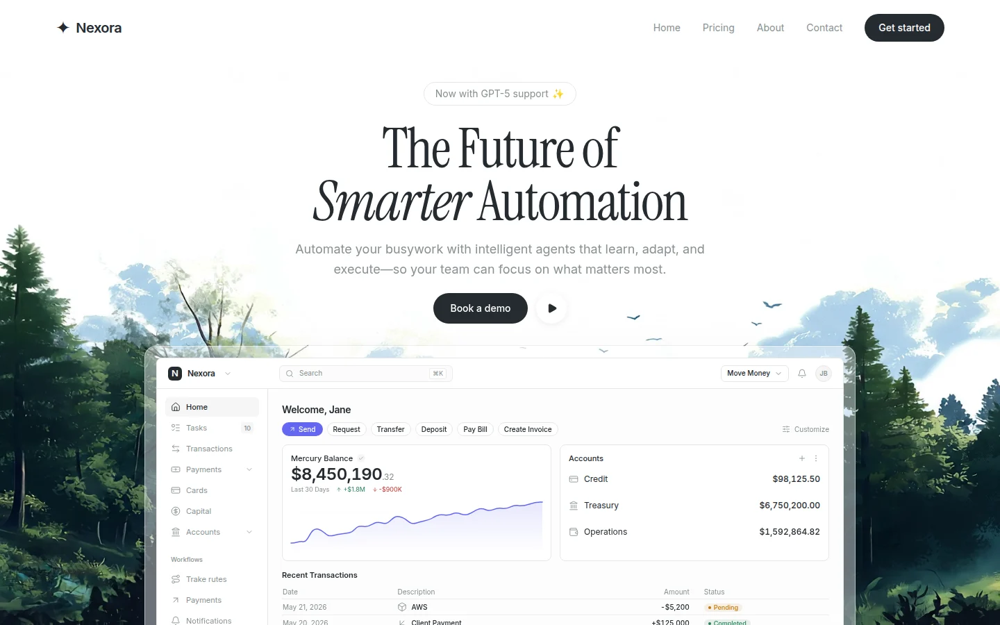

# Nexora Automation

Лендинг по заданному дизайну: один экран, анимированный лес на фоне, Instrument Serif и Inter, плавное появление элементов и dashboard, полностью собранный из React-компонентов.



[Мобильный вид](docs/preview-mobile.webp) · [Результаты проверки](docs/VERIFICATION.md)

## Запуск в Windows — двойным щелчком

1. [Скачайте весь проект ZIP-архивом](https://github.com/DeepDlueIV/Nexora-Automation/archive/refs/heads/main.zip).
2. **Распакуйте архив полностью** в обычную папку.
3. Дважды нажмите **`START-WEBSITE.cmd`** в корне распакованной папки.

Лаунчер сам подготовит зависимости, соберёт сайт, запустит локальный сервер и откроет готовую страницу в браузере по умолчанию. Вручную вводить команды не требуется.

Если подходящий Node.js уже установлен, используется он. Иначе лаунчер загрузит переносимую LTS-версию с официального `nodejs.org`, проверит SHA256 и распакует её в `.runtime` внутри проекта. Поддерживаются Windows x64 и ARM64. Постоянная установка Node.js в систему и права администратора не нужны.

Первый запуск требует интернета для загрузки отсутствующих компонентов. Повторный запуск проверяет и использует уже установленные зависимости. Сайт пересобирается при каждом запуске, поэтому изменения в исходниках появятся после перезапуска.

Обычный адрес — **http://127.0.0.1:4173/**. Если порт занят, автоматически выбирается следующий свободный и открывается правильный адрес. Другие программы не закрываются.

**Оставляйте окно лаунчера открытым, пока пользуетесь сайтом. Для остановки нажмите `Ctrl+C`.** Если запуск завершился ошибкой, окно сохранит текст ошибки.

> Запускайте файл из распакованного проекта, а не прямо из ZIP-архива. Один скачанный `.cmd` без остальных файлов сайта работать не будет.

## Что реализовано

- Navbar и Hero занимают один экран; страница не прокручивается. На мобильных устройствах учитывается динамическая высота видимой области браузера.
- Светлая тема, заданные HSL-токены, Instrument Serif с курсивом для **Smarter**, Inter для интерфейса.
- Указанный в ТЗ видеофон: autoplay, muted, loop, playsInline и object-cover. Локальный кадр леса отображается до загрузки видео и при недоступности видеосервера.
- Анимации Framer Motion с заданными сдвигами, длительностями и задержками. При включённом в системе уменьшении движения анимации отключаются, фон остаётся статичным.
- Кнопки shadcn/ui, иконки lucide-react, Tailwind CSS 3 и tailwindcss-animate.
- Dashboard написан на React: верхняя панель, боковая навигация, равные карточки баланса и счетов, SVG-график на кривых Безье и четыре транзакции с исходными суммами и статусами. Это декоративное превью без активных платёжных элементов.
- Кнопка **Play** открывает интерактивный тур из трёх шагов. **Pricing**, **About**, **Contact**, **Get started** и **Book a demo** открывают соответствующие диалоги.
- Диалоги поддерживают клавиатуру, удержание фокуса, закрытие через `Esc` и возврат фокуса к исходной кнопке.

## Запись на демо и контакты

Это готовый интерфейс лендинга; сервер агентов, платежи и обработка заявок в объём проекта не входят. Надпись о GPT-5 и финансовые данные dashboard сохранены из предоставленного ТЗ и не означают подключение к AI API или банковскому счёту.

Адрес календаря записи, контактная почта и цены не были указаны в исходных данных. Поэтому сайт не подставляет выдуманные реквизиты, цены или подтверждения отправки заявки. Пока адреса не заданы, соответствующие диалоги честно сообщают о недоступности записи/контактов и предлагают интерактивный тур.

Для подключения реальных действий скопируйте `.env.example` в `.env` и укажите нужные значения:

```dotenv
VITE_BOOKING_URL=
VITE_CONTACT_EMAIL=
```

- `VITE_BOOKING_URL` — полный HTTP/HTTPS-адрес вашего календаря. В диалоге демо появится **Choose a time**.
- `VITE_CONTACT_EMAIL` — почта для связи. В **Contact** появится почтовая ссылка; при отсутствии календаря запрос демо также будет открываться в почтовом приложении.

Перезапустите лаунчер после изменения `.env`. Эти значения публичны и встраиваются в браузерную сборку: не помещайте в них секреты или API-ключи.

## macOS / Linux

Требуется установленный **Node.js 22.12 или новее** с npm.

```bash
bash start-website.sh
```

Дальше установка зависимостей, сборка, запуск сервера и открытие браузера выполняются автоматически.

## Разработка и проверка

```bash
npm ci
npm run dev
```

| Команда | Назначение |
|---|---|
| `npm start` | Подготовка, production-сборка, локальный сервер и открытие браузера |
| `npm run dev` | Сервер разработки с обновлением при изменении исходников |
| `npm run build` | Проверка TypeScript и production-сборка в `dist/` |
| `npm run preview` | Локальный просмотр уже собранного `dist/` |
| `npm run typecheck` | Проверка TypeScript |
| `npm run test:e2e` | Браузерные проверки в Chromium и Firefox |

Перед первым запуском браузерных тестов:

```bash
npx playwright install chromium firefox
npm run build
npm run test:e2e
```

Тесты проверяют размеры от **320 × 568** до **1440 × 900**, планшетную и альбомную ориентацию, отсутствие прокрутки страницы, видимость CTA, содержимое dashboard, тур, диалоги и клавиатурный фокус. Функциональные тесты блокируют внешние шрифты и видео, чтобы также проверять работу при недоступности внешних ресурсов. Визуальная проверка со шрифтами и видео проводится отдельно.

Для автоматических проверок лаунчера:

```bash
node scripts/start-local.mjs --no-open
```

Дополнительные переменные: `NEXORA_NO_OPEN=1` отключает открытие браузера; `NEXORA_PORT` задаёт предпочтительный порт; `NEXORA_NO_PAUSE=1` убирает паузу CMD после ошибки. После успешной проверки HTTP лаунчер печатает `NEXORA_READY` и фактический адрес.

## Структура

```text
START-WEBSITE.cmd              Запуск в Windows
start-website.sh               Запуск в macOS / Linux
scripts/start-local.ps1        Поиск / подготовка Node.js для Windows
scripts/start-local.mjs        Установка, сборка, сервер, открытие браузера
src/App.tsx                   Композиция Hero и управление диалогами
src/index.css                 Шрифты, токены, адаптивные стили
src/components/navbar.tsx     Верхняя навигация
src/components/dashboard-preview.tsx  Кодовое превью dashboard
src/components/background-video.tsx  Видеофон и reduced motion
src/components/site-dialog.tsx       Информационные диалоги
src/components/product-tour.tsx      Интерактивный тур
src/components/ui/button.tsx   Компонент shadcn/ui Button
src/lib/site-config.ts        Настройки календаря, почты и видео
public/forest-poster.webp      Локальный кадр указанного видеофона
tests/landing.spec.ts          Браузерные проверки
```

## Внешние ресурсы

Видеофон использует исходную ссылку из ТЗ; в Git не включён сам MP4. `public/forest-poster.webp` — кадр из этого видео. Шрифты загружаются из Google Fonts через CSS. Поэтому для воспроизведения видео и загрузки шрифтов нужен доступ к соответствующим внешним серверам; при их недоступности остаются локальный постер и резервные системные шрифты.

Компонент Button адаптирован из shadcn/ui; текст его лицензии сохранён в [THIRD_PARTY_NOTICES.md](THIRD_PARTY_NOTICES.md).
